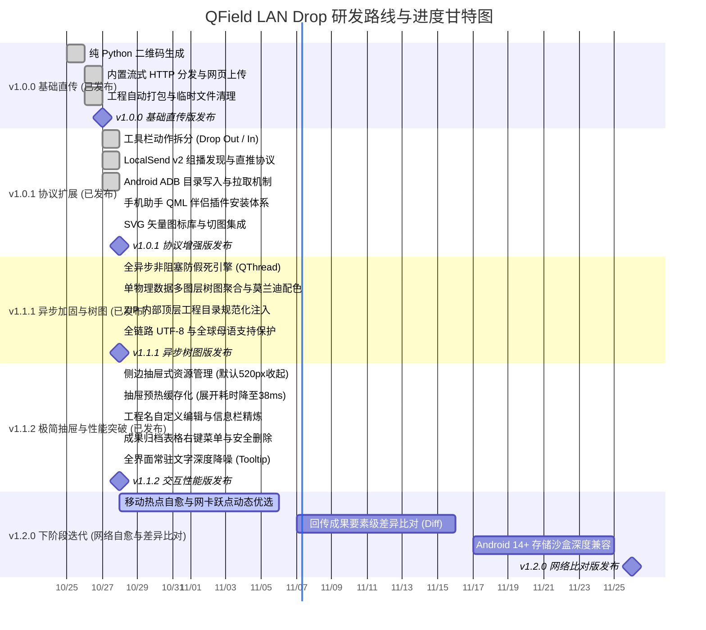

# QField LAN Drop 研发路线图 (Roadmap)

本文档记录 QField LAN Drop 插件的版本发布记录、当前冲刺任务与后续规划。

---

## 一、 研发周期横向甘特图 (Mermaid Gantt)

---

## 二、 特性矩阵与进度指标 (Feature Matrix)

统一采用 10 段式 Unicode 进度条展示特性成熟度：

| 阶段 / 里程碑 | 特性模块 | 排期规划 | 状态 | 进度条 | 说明与技术攻关点 |
| :--- | :--- | :---: | :---: | :--- | :--- |
| **v1.0.0 (已发布)** | **扫码唤醒与流式分发** | 10/25 - 10/27 | ✅ 已发布 | `██████████` 100% | 纯 Python 二维码渲染，通过 `qfield://` 深度链接唤醒导入工程 |
| **v1.0.1 (已发布)** | **动作拆分与直接打开** | 10/27 - 10/28 | ✅ 已发布 | `██████████` 100% | 投送与接收拆分为独立动作，接收回传无需等待重新打包 |
| **v1.0.1 (已发布)** | **LocalSend 协议支持** | 10/27 - 10/28 | ✅ 已发布 | `██████████` 100% | UDP 组播发现局域网内的手机，支持免扫码直接推送 |
| **v1.0.1 (已发布)** | **ADB 文件传输** | 10/27 - 10/28 | ✅ 已发布 | `██████████` 100% | 支持通过 USB 与局域网写入 QField 应用目录或拉回成果包 |
| **v1.0.1 (已发布)** | **QField 手机助手安装器** | 10/28 - 10/28 | ✅ 已发布 | `██████████` 100% | 支持通过扫码、深度链接或 ADB 部署伴侣 QML 插件 |
| **v1.1.1 (已发布)** | **全异步非阻塞防假死架构** | 10/28 - 10/28 | ✅ 已发布 | `██████████` 100% | ZIP 压缩、ADB 拉取、成果解压全量移入后台 QThread，杜绝系统未响应 |
| **v1.1.1 (已发布)** | **图层树图单物理数据聚合** | 10/28 - 10/28 | ✅ 已发布 | `██████████` 100% | 聚合同物理数据多图层为单一色块，采用淡雅莫兰迪灰紫配色与外部醒目微标 |
| **v1.1.1 (已发布)** | **ZIP 顶层目录与全链路 UTF-8** | 10/28 - 10/28 | ✅ 已发布 | `██████████` 100% | 注入顶层工程目录规范导入，采用 RFC 5987 与 Bit-11 杜绝跨系统乱码 |
| **v1.1.2 (已发布)** | **侧边抽屉 Inspector 架构** | 10/28 - 10/28 | ✅ 已发布 | `██████████` 100% | 告别阻断弹窗，默认 520px 紧凑收起，点击向右平滑展开为 940px，收起零留白 |
| **v1.1.2 (已发布)** | **抽屉展开毫秒级性能优化** | 10/28 - 10/28 | ✅ 已发布 | `██████████` 100% | 消除展开时主线程扫描磁盘的 250ms+ 阻塞，预热缓存使展开耗时降至 38ms |
| **v1.1.2 (已发布)** | **工程名自定义与信息栏瘦身** | 10/28 - 10/28 | ✅ 已发布 | `██████████` 100% | 支持自由修改导出工程名，精简大小标签，彻底删除包含文件数冗余文本 |
| **v1.1.2 (已发布)** | **成果归档右键菜单与安全删除** | 10/28 - 10/28 | ✅ 已发布 | `██████████` 100% | 增加右键菜单与 Del 快捷键，支持安全确认物理删除、系统定位与一键载入 |
| **v1.1.2 (已发布)** | **全界面常驻文字深度降噪** | 10/28 - 10/28 | ✅ 已发布 | `██████████` 100% | 大段说明书全面转为 `ℹ️`/`⚠️` 微标与悬停 Tooltip，降噪 70% |
| **v1.2.0 (下期迭代)** | **热点自愈与多网卡智能优选** | 10/28 - 11/06 | 🔄 进行中 | `████░░░░░░` 40% | 笔记本自建热点时优先绑定当前可用最佳内网 IP |
| **v1.2.0 (下期迭代)** | **外业回传要素级差异比对** | 11/07 - 11/16 | 💡 待启动 | `░░░░░░░░░░` 0% | 比对回传 GPKG 与本地原工程要素变动并高亮显示 |
| **v1.2.0 (下期迭代)** | **Android 14+ 存储沙盒适配** | 11/17 - 11/25 | 💡 待启动 | `░░░░░░░░░░` 0% | 适配不同厂商系统的存储权限限制，提高导入成功率 |
| **v1.3.0 (远期规划)** | **增量差分打包 (Delta Sync)**| 11/26 - 12/10 | 💡 待启动 | `░░░░░░░░░░` 0% | 仅传输修改过的属性与几何要素，减少无线传输量 |
| **v1.3.0 (远期规划)** | **多机并行广播分发** | 12/11 - 12/25 | 💡 待启动 | `░░░░░░░░░░` 0% | 支持单台电脑向多台手机同时分发工程包 |

---

## 三、 当前冲刺重点任务 (v1.2.0 Sprint)

- [ ] **热点自愈与网卡智能优选**：针对野外笔记本开启移动热点场景，智能识别虚拟适配器并推荐热点网段；
- [ ] **回传成果要素级差异比对**：回传解压后比对图层要素总数与修改时间戳，生成比对清单并可视化上图；
- [x] **向右抽屉 Inspector 架构 (v1.1.2)**：默认 520px 紧凑收起，用户点击向右展开至 940px，收拢无多余空白；
- [x] **抽屉毫秒级性能突破 (v1.1.2)**：预热缓存消除 250ms+ 磁盘扫描，展开仅需 38ms；
- [x] **工程名自定义与信息栏精简 (v1.1.2)**：支持单行输入框自定义名称重新打包，移除包含文件数；
- [x] **成果回收表格右键菜单与安全删除 (v1.1.2)**：支持 Del 物理删除、系统高亮定位、直接载入与解压；
- [x] **全界面文字降噪 (v1.1.2)**：长文本说明书全面收纳至 `ℹ️`/`⚠️` 悬停 Tooltip；
- [x] **全异步防假死架构 (v1.1.1)**：ZIP 压缩、ADB 交互、成果解压全量移入后台线程；
- [x] **图层树图单物理数据聚合 (v1.1.1)**：多图层合一图形展示，换用莫兰迪淡雅配色；
- [x] **顶层目录注入与全链路 UTF-8 (v1.1.1)**：解决解压无文件夹名问题，全语种原生支持；
- [x] **工具栏成对动作拆分 (v1.0.1)**：独立【投送】与【接收】动作，收工回传无需等待重新打包；
- [x] **LocalSend v2 组播推送 (v1.0.1)**：局域网发现手机端 LocalSend 设备并推送；
- [x] **手机助手安装体系 (v1.0.1)**：支持扫码、URL 深度链接、ADB 写入与离线包等安装方式；
- [x] **全矢量图标体系 (v1.0.1)**：统一采用 SVG 矢量图标。

---

## 四、 贡献与建议

可通过 GitHub Issues 提交特性建议或缺陷反馈：  
[提交 Issue / Feature Request](https://github.com/OpenQGIS/QFieldDrop/issues)

---

## 四、 贡献与建议

可通过 GitHub Issues 提交特性建议或缺陷反馈：  
[提交 Issue / Feature Request](https://github.com/OpenQGIS/QFieldDrop/issues)
