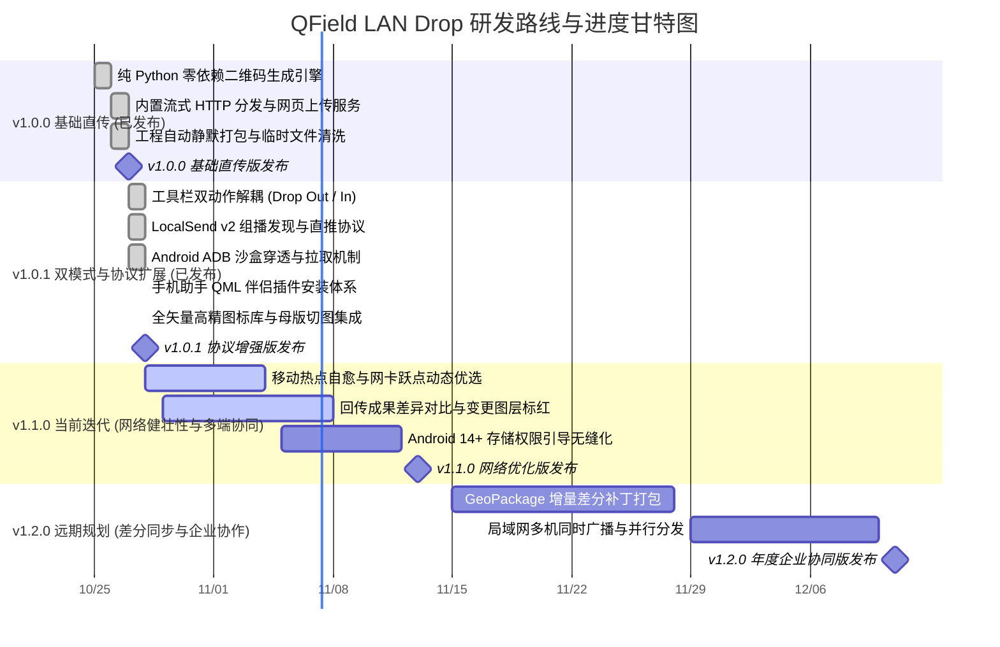

# QField LAN Drop 研发路线图 (Roadmap)

本文档规划了 **QField LAN Drop**（QField 局域网极速离线双向直传）插件的功能演进蓝图、当前冲刺进度及远期演进目标。

---

## 一、 研发周期横向甘特图 (Mermaid Gantt)

---

## 二、 特性矩阵与进度指标 (Feature Matrix)

统一采用 10 段式 Unicode 进度条展示特性成熟度：

| 阶段 / 里程碑 | 特性模块 | 排期规划 | 状态 | 进度条 | 说明与技术攻关点 |
| :--- | :--- | :---: | :---: | :--- | :--- |
| **v1.0.0 (已发布)** | **扫码唤醒与流式分发** | 10/25 - 10/27 | ✅ 已发布 | `██████████` 100% | 纯 Python 二维码渲染，`qfield://` 深度链接唤醒导入工程 |
| **v1.0.1 (已发布)** | **双动作分离与毫秒秒开** | 10/27 - 10/28 | ✅ 已发布 | `██████████` 100% | 投送与接收独立解耦，收工回传跳过打包秒级响应 |
| **v1.0.1 (已发布)** | **LocalSend 协议支持** | 10/27 - 10/28 | ✅ 已发布 | `██████████` 100% | UDP 组播发现局域网手机，支持一键免扫码直推 |
| **v1.0.1 (已发布)** | **ADB 沙盒穿透与拉取** | 10/27 - 10/28 | ✅ 已发布 | `██████████` 100% | Android 11+ 存储隔离穿透，无线与有线一键拉回成果包 |
| **v1.0.1 (已发布)** | **QField 手机助手安装器** | 10/28 - 10/28 | ✅ 已发布 | `██████████` 100% | 扫码/深度链接/ADB 一键将伴侣 QML 插件写入手机 |
| **v1.1.0 (当前迭代)** | **热点自愈与多网卡智能优选** | 10/28 - 11/04 | 🔄 进行中 | `████░░░░░░` 40% | 笔记本外场自建热点时优先绑定外网/无外网内网最佳 IP |
| **v1.1.0 (当前迭代)** | **外业回传差异比对** | 10/29 - 11/08 | 🔄 进行中 | `██░░░░░░░░` 20% | 自动比对回传 GPKG 与本地原工程要素变动并高亮标记 |
| **v1.1.0 (下期迭代)** | **Android 14+ 权限平滑适配** | 11/05 - 11/12 | 💡 待启动 | `░░░░░░░░░░` 0% | 规避部分国产定制系统严格沙盒限制，提升导入成功率 |
| **v1.2.0 (远期规划)** | **增量差分打包 (Delta Sync)**| 11/15 - 11/28 | 💡 待启动 | `░░░░░░░░░░` 0% | 仅传输修改过的属性与几何要素，节省 90%% 以上无线传输流量 |
| **v1.2.0 (远期规划)** | **群组多端并行下发** | 11/29 - 12/10 | 💡 待启动 | `░░░░░░░░░░` 0% | 一台作业班长电脑同时向多台作业员手机广播工程包 |

---

## 三、 当前冲刺重点任务 (v1.1.0 Sprint)

- [ ] **热点自愈与网卡智能优选**：针对野外笔记本开启移动热点无互联网连接场景，智能识别虚拟适配器并优先推荐热点网段；
- [ ] **回传成果差异变动比对**：回传解压后快速比对图层要素总数与修改时间戳，生成简要比对报表；
- [x] **工具栏成对动作彻底解耦 (v1.0.1)**：独立【📤 投送】与【📥 接收】Action，实现收工回传无需等待重新打包；
- [x] **LocalSend v2 组播直推 (v1.0.1)**：免扫码局域网发现手机端 LocalSend 设备并一键推送；
- [x] **手机助手多模态安装 (v1.0.1)**：支持扫码、URL 深度链接、ADB 写入与离线包等全通道安装伴侣插件；
- [x] **全矢量高精图标体系 (v1.0.1)**：统一采用 100% SVG 矢量设计与母版批量切图流程。

---

## 四、 贡献与建议

欢迎通过 GitHub Issues 提交新特性建议或缺陷反馈：  
👉 [提交 Issue / Feature Request](https://github.com/OpenQGIS/QFieldDrop/issues)
